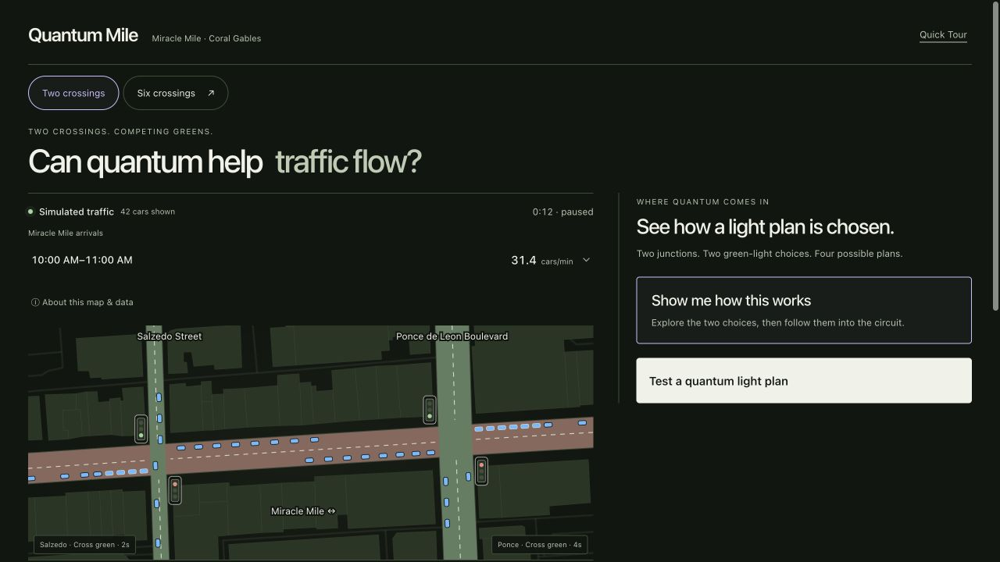
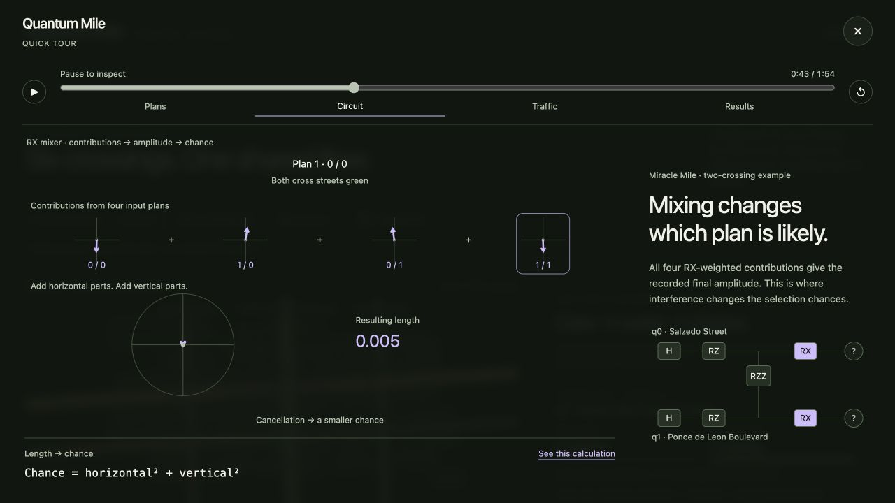
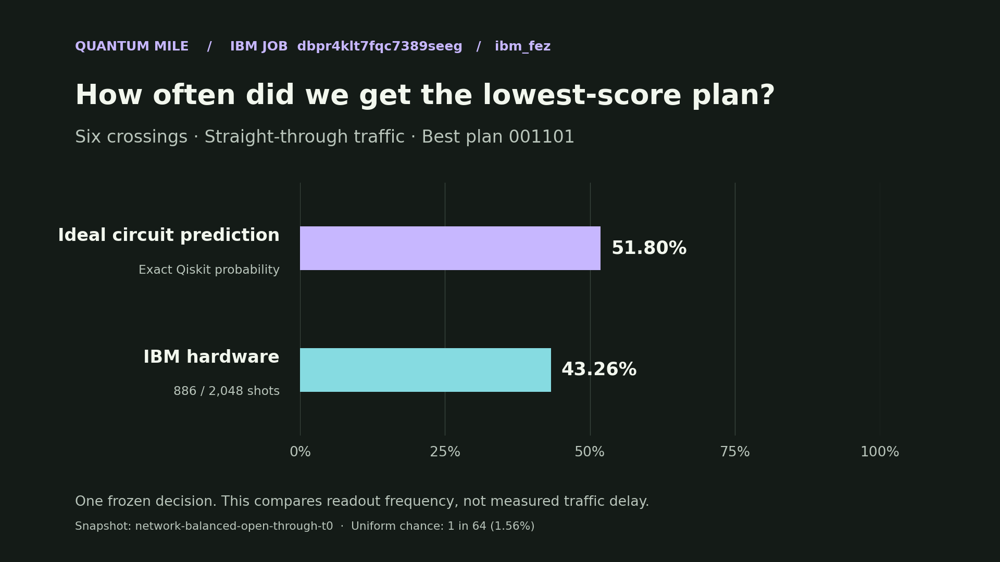

# Quantum Mile

An interactive experiment in traffic signal coordination on Miracle Mile in Coral Gables, Florida. A green light can clear one queue while sending cars into an already full block. Quantum Mile lets you compare fixed cycling, exact classical search, and a quantum sampler on the same modeled traffic.

Built for the [IBM Quantum: Qiskit Fall Fest Hackathon](https://luma.com/deepst-fufs).

[Open the live Quantum Mile playground](https://quantum-mile.tarpit-ai.chatgpt.site/) · Available to approved viewers.



*The two-crossing playground on Miracle Mile. Map data © [OpenStreetMap contributors](https://www.openstreetmap.org/copyright).*

## How the circuit picks a plan

Start with two crossings and four possible plans. The circuit encodes traffic costs as phases, then mixes their amplitudes to change each plan’s chance of being selected. A measurement picks one plan. The six-crossing experiment uses the same approach with up to 64 plans.



## What IBM Fez measured

For one frozen six-crossing decision, the lowest-score plan `001101` appeared in **886 of 2,048 shots (43.26%)** on IBM Fez. Ideal Qiskit predicted **51.80%** for the same plan. See the [executed notebook](Quantum-Mile-Submission.ipynb) and [recorded counts](hardware.json).



In eight separate matched traffic simulations, the ideal quantum sampler had lower mean modeled delay than exact classical search in two cases and higher delay in six. The hardware result concerns one fixed snapshot. The traffic comparisons cover one simulated minute per scenario. See the [full comparison data](comparisons.json).

## Reproduce the recorded decision

Use Python 3.14 (verified locally with 3.14.6). From this directory:

```sh
python3 -m venv .venv
source .venv/bin/activate
python -m pip install -r requirements-lock.txt jupyterlab
jupyter lab Quantum-Mile-Submission.ipynb
```

Open **Quantum-Mile-Submission.ipynb** and select **Run All**. The notebook checks the fixture, enumerates the allowed plans, reconstructs the circuit, and compares the ideal result with saved IBM counts. The notebook runs locally with saved IBM counts and includes its original outputs.

- `fixtures.json`, `quantum_core.py`, `verification.json`: frozen traffic decision, Qiskit construction and ideal verification.
- `hardware.json`, `hardware/`: IBM `ibm_fez` job `dbpr4klt7fqc7389seeg`, raw counts, compiled QPY and logical QASM.
- `comparisons.json`: eight separate, matched, one-minute traffic simulation scenarios with a declared seed and the three controllers.
- `source/` and `DATA-SOURCES.md`: relevant model code, assumptions and data provenance.
